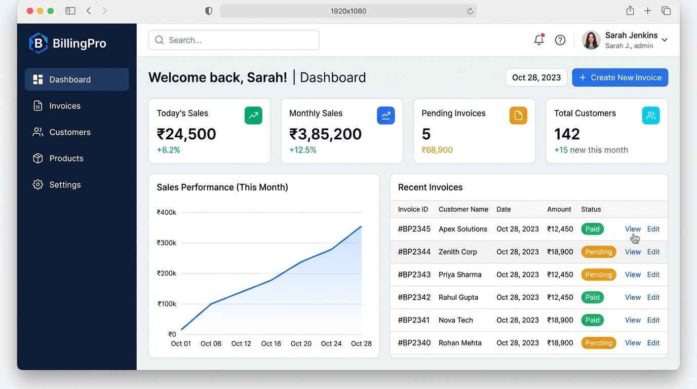
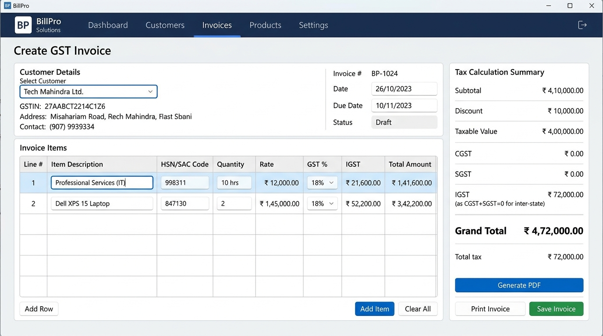

# Billing Software

A complete desktop billing, GST invoicing, and inventory management software built with **Electron**, **React**, **SQLite**, and **Tailwind CSS**.

> **Important:** This is proprietary software owned by **Yukti Tech Solution**. It is not open source. Access and usage are strictly limited to licensed customers and partners. For licensing or purchasing, contact [https://yuktitechsolution.co.in/](https://yuktitechsolution.co.in/) or email [yuktitechsolution@gmail.com](mailto:yuktitechsolution@gmail.com).

---

## 📸 User Interface Screenshots

### 1. Analytics & Executive Dashboard
Real-time sales performance, monthly trends, pending invoices tracking, and quick management links:



### 2. GST Invoice Generator & Billing Workspace
Automated HSN/SAC code handling, dynamic tax calculation (CGST / SGST / IGST), customer selector, and instant PDF/Print generation:



---

## 🚀 Key Features

- **Executive Dashboard**: Real-time sales statistics (daily, monthly, yearly), cash flow tracking, pending balance monitoring, and recent transactions.
- **GST Invoice Creation**: Intuitive invoice composer with automatic HSN/SAC lookups, rate calculation, dynamic GST percentages, discounts, and auto-generated amount in words.
- **Invoice Preview & Print**: Professional GST invoice template with company logo, tax breakdowns, direct Electron printing, and instant PDF download.
- **Organized Storage**: Invoices are cleanly auto-saved to organized monthly folders: `data/bills/[MM-YYYY]/[INV-NO].pdf`.
- **Customer Management**: Add, search, view transaction histories, edit, and organize client contact records and GSTIN details.
- **Product & Inventory Management**: Manage catalog items, pricing, HSN codes, tax brackets, and available stock levels.
- **Company Settings**: Configure business details, address, state codes, GSTIN, and custom branding logo.
- **Offline-First SQLite Database**: Lightning-fast offline reliability using `better-sqlite3` — zero latency and local data safety.
- **License & Auth System**: Built-in test credential support, activation key management, and cloud/Firebase synchronization options.

---

## 🛠️ Technology Stack

| Layer | Technologies |
|---|---|
| **Desktop Shell** | Electron 28 |
| **Frontend UI** | React 18, React Router v6 |
| **Styling** | Tailwind CSS 3, PostCSS |
| **Local Database** | SQLite via `better-sqlite3` |
| **Bundler & Tooling** | Vite 5 |
| **PDF & Export** | jsPDF, jsPDF-AutoTable |
| **Cloud Sync & Auth** | Firebase 10 (Optional) |
| **Utilities** | date-fns, react-toastify |

---

## 📋 System Prerequisites

- **Node.js**: v18 LTS or v20 LTS (Recommended: Node.js 20.x)
- **Package Manager**: npm (bundled with Node.js)
- **Windows Users**: Visual Studio Build Tools with **Windows 10/11 SDK** (required for compiling native `better-sqlite3` bindings).

---

## ⚡ Quick Start (Windows)

The simplest and fastest way to start on Windows:

1. Double-click **`run-project.bat`** in the project root folder.
2. The script will automatically:
   - Check Node.js and environment prerequisites
   - Install dependencies if missing
   - Verify native bindings
   - Launch Vite development server on port `5180` and start the Electron desktop window.

*(Use `run-project.bat --force-install` if you ever need to clean-reinstall all dependencies).*

---

## 💻 Manual Setup & Installation

### Step 1: Windows C++ Build Tools (Windows Users)
Before installing packages, ensure the Windows SDK is present:
1. Open **Visual Studio Installer** from your Windows Start Menu.
2. Click **Modify** next to *Visual Studio Build Tools* (or *Visual Studio Community*).
3. Under the **Individual components** tab, search for and check **Windows 10 SDK** (or **Windows 11 SDK**).
4. Click **Modify** to complete the installation.

### Step 2: Clone & Install Dependencies
```bash
# Clone the repository
git clone https://github.com/Yukti-Tech-Solution/General-Billing-Software.git
cd General-Billing-Software

# Install project dependencies
npm install
```

> **Note on Native Modules:** If `better-sqlite3` fails to compile, run:
> ```bash
> npm run rebuild
> ```

---

## 🏃 Running the Application

### Development Mode
```bash
npm run electron-dev
```
This starts:
- Vite development server on `http://localhost:5180`
- Electron shell with Hot Module Replacement (HMR) and DevTools enabled.

---

## 🔑 Demo & Test Credentials

The system includes preconfigured demo accounts for evaluating features:

| Role | Email | Password | Access Level |
|---|---|---|---|
| **Administrator** | `vaibhavwaghalkar2@gmail.com` | `admin123` | Full Unlimited Access |
| **Test User** | `test@yuktitechsolution.com` | `test123` | Unlimited Access |
| **Demo Account** | `demo@demo.com` | `demo123` | Trial / Standard Access |

*Tip: Press `Ctrl + Shift + L` inside the application to toggle Administrator Mode for license management.*

---

## 📦 Building for Production

To generate distributable desktop installers:

```bash
# 1. Build frontend bundle
npm run build

# 2. Package for Windows (.exe installer)
npm run dist:win

# Or package for macOS / Linux:
npm run dist:mac
npm run dist:linux
```

All compiled binaries will be output to the `dist/` folder.

---

## 📂 Project Architecture

```
billing-software/
├── docs/                     # Documentation assets and screenshots
│   └── screenshots/          # UI previews (dashboard, invoice, etc.)
├── electron/                 # Electron main process
│   ├── main.js               # IPC handlers, window lifecycle & SQLite setup
│   └── preload.js            # Secure contextBridge API bindings
├── src/                      # React frontend source
│   ├── components/           # Reusable UI components
│   │   ├── CustomerForm.jsx
│   │   ├── Header.jsx
│   │   ├── InvoicePreview.jsx
│   │   ├── LicenseActivation.jsx
│   │   ├── LoginScreen.jsx
│   │   ├── ProductForm.jsx
│   │   └── Sidebar.jsx
│   ├── database/             # SQLite schema and query abstraction
│   │   ├── db.js
│   │   └── schema.js
│   ├── firebase/             # Firebase cloud integration & license checks
│   │   ├── config.js
│   │   └── licenseService.js
│   ├── pages/                # Application views
│   │   ├── CreateInvoice.jsx
│   │   ├── Customers.jsx
│   │   ├── Dashboard.jsx
│   │   ├── InvoiceHistory.jsx
│   │   ├── LicenseManagement.jsx
│   │   ├── Products.jsx
│   │   └── Settings.jsx
│   ├── utils/                # Calculations, PDF generator & helpers
│   │   ├── calculations.js
│   │   ├── numberToWords.js
│   │   ├── pdfGenerator.js
│   │   └── testCredentials.js
│   ├── App.jsx               # Application routes and license state
│   ├── index.jsx             # React DOM root
│   └── index.css             # Tailwind base styles
├── .env.example              # Environment variables template
├── run-project.bat           # Automated 1-click startup batch script
├── package.json              # App configuration and scripts
├── vite.config.js            # Vite build configuration
└── tailwind.config.js        # Tailwind CSS theme configuration
```

---

## 🗄️ Database Structure

The local SQLite database stores data under `%APPDATA%/billing-software/billing.db` (Windows):

- **`companies`**: Profile details, address, contact, GSTIN, and custom logo.
- **`customers`**: Client directories, contact numbers, billing addresses, and GSTIN.
- **`products`**: Item names, descriptions, unit rates, HSN codes, tax rates, and inventory stock.
- **`invoices`**: Sequential invoice numbers (`INV-YYYY-###`), customer references, date, tax summaries, discounts, paid amounts, balance, and notes.
- **`invoice_items`**: Line items linked to invoices with quantities, unit rates, and totals.
- **`licenses`**: Activation status, hardware keys, expiry dates, and subscription info.

---

## 📄 License

**Proprietary License** — © 2025–2026 **Yukti Tech Solution**. All rights reserved.

Unauthorized copying, modification, reverse engineering, redistribution, or public deployment of this software is strictly prohibited without prior written agreement from Yukti Tech Solution.

See [LICENSE.txt](file:///d:/Programming/Yukti%20Tech%20Solution/Billing%20Software/LICENSE.txt) for full terms.

---

## 📞 Support & Inquiries

- **Official Website**: [https://yuktitechsolution.co.in/](https://yuktitechsolution.co.in/)
- **Email Contact**: [yuktitechsolution@gmail.com](mailto:yuktitechsolution@gmail.com)
- **Documentation Guides**:
  - [ENV_SETUP.md](file:///d:/Programming/Yukti%20Tech%20Solution/Billing%20Software/ENV_SETUP.md) — Firebase configuration guide
  - [QUICK_START.md](file:///d:/Programming/Yukti%20Tech%20Solution/Billing%20Software/QUICK_START.md) — 5-minute setup walkthrough
  - [TROUBLESHOOTING.md](file:///d:/Programming/Yukti%20Tech%20Solution/Billing%20Software/TROUBLESHOOTING.md) — Resolving build and runtime issues
  - [FIREBASE_SETUP.md](file:///d:/Programming/Yukti%20Tech%20Solution/Billing%20Software/FIREBASE_SETUP.md) — Cloud licensing and sync setup
